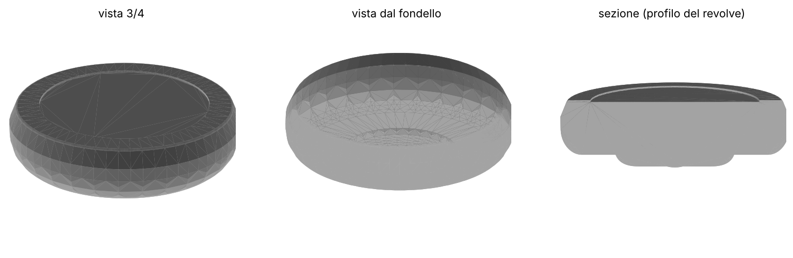

# mysuuntoocean

Modello 3D parametrico della Suunto Ocean, costruito con [CadQuery](https://cadquery.readthedocs.io).

## Fase 1: corpo cassa (revolve)

Il corpo è la rivoluzione a 360° della mezza sezione dell'orologio, presa dal
disegno tecnico ufficiale (Ø 49,9 mm, spessore 15,1 mm). Anse e bottoni non ci sono ancora.



Profilo del modello (in verde) sovrapposto al disegno tecnico:


## Uso

```bash
pip install -r requirements.txt
python watch_body.py                         # -> export/suunto_ocean_body.step + .stl
python tools/overlay.py <disegno.png> docs/overlay.png
python tools/render.py docs/render.png
```

Tutte le quote sono costanti in cima a `watch_body.py`.
