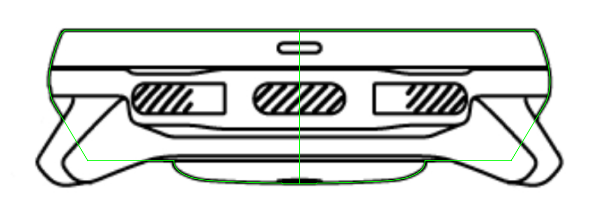
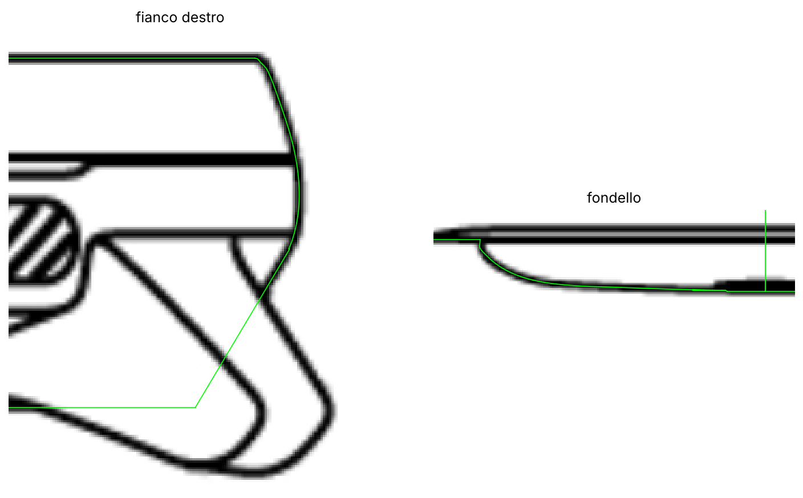

# mysuuntoocean

Modello 3D parametrico della Suunto Ocean, costruito con [CadQuery](https://cadquery.readthedocs.io).

## Fase 1: corpo cassa (revolve)

Il corpo è la rivoluzione a 360° della mezza sezione dell'orologio. La sezione non è
disegnata a mano: `tools/trace_profile.py` la ricalca sul disegno tecnico ufficiale
(`reference/suunto_ocean_drawing.png`), misurando la mezzeria di ogni tratto con
precisione sub-pixel (scala dalla quota Ø 49,9 mm = 624,2 px).

- Faccia superiore piana, raccordo e fianco di lunetta/cassa: ricalcati riga per riga.
- Sotto la lunetta il fianco è una retta (pendenza 0,594, letta nel tratto visibile
  tra le anse) prolungata fino alla linea di fondo **più bassa** del disegno.
- Fondello bombato e gradino del sensore: ricalcati colonna per colonna.
- Le linee orizzontali che attraversano tutta la vista (lunetta/cassa, attacco anse,
  linea di fondo più alta) sono giunzioni tra pezzi e non cambiano il profilo.

Scarto tra il modello e il disegno: medio 0,24 px, massimo 0,79 px (0,063 mm).
Spessore risultante dal disegno: 15,32 mm (il dato ufficiale è 15,1 mm).




## Fase 2: piattaforma dei tasti + tasti

Il corpo della fase 1 non cambia. `watch_buttons.py` aggiunge due layer separati,
ricavati da `tools/trace_buttons.py` (`data/buttons_mm.json`):

- **Piattaforma** (`export/suunto_ocean_platform.*`): loft di sezioni radiali da -46° a
  +46° (passo 1.5°). Ogni sezione, vista di lato: dalla giunzione con la lunetta la
  superficie si apre fino a una spalla (z 10.96, la linea "a lente" della vista frontale),
  scende in verticale al raggio del contorno in pianta, e sotto rientra inclinata fino al
  fianco del corpo (bordo esterno z 5.84 sui lobi, 5.35 sotto il tasto centrale; incontro
  col fianco a z 4.57: le linee y≈427/433/443 della vista frontale). Il contorno in pianta
  è il bordo in comune con il tasto, ricalcato, che alle estremità entra tangente nel
  cerchio della cassa (`BLEND_END_DEG`); verso le anse la fascia si riassorbe nel corpo.
- **Tasti** (`export/suunto_ocean_buttons.*`): ogni tasto è l'intersezione tra la forma in
  pianta (estrusa in verticale) e la sagoma della vista frontale (estrusa in profondità),
  quindi entrambe le viste coincidono con il disegno. Le dentellature sono le tacche
  del contorno in pianta. In pianta la parte interna dei tasti laterali è coperta dalla
  piattaforma e dal bordo della cassa: lì l'estensione la decide la vista frontale.
- `export/suunto_ocean_case.*` = corpo + piattaforma in un solido unico.

Le anse non ci sono ancora.

## Uso

```bash
pip install -r requirements.txt
python tools/trace_profile.py      # disegno -> data/profile_mm.json
python watch_body.py               # -> export/suunto_ocean_body.step + .stl
python tools/trace_buttons.py      # disegno -> data/buttons_mm.json
python watch_buttons.py            # -> export/suunto_ocean_{platform,buttons,case}.step + .stl
python tools/overlay.py            # controllo: docs/overlay.png, docs/overlay_zoom.png + scarto
python tools/export_preview.py     # anteprima web: docs/preview.html + piani di riferimento docs/ref_*.png
```
